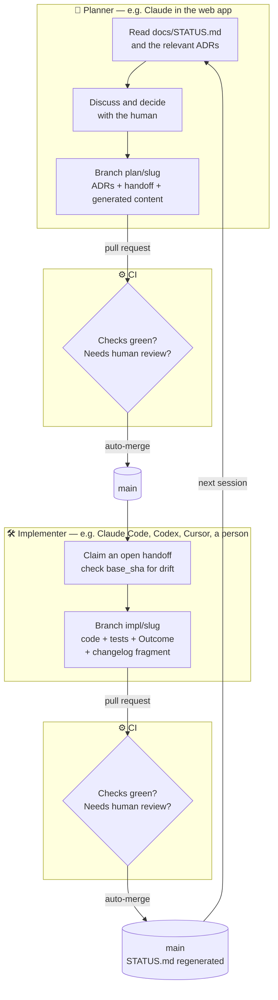

<div align="center">

# agent-workflow

**One repository. Many agents. No copy-paste.**

A small, version-controlled protocol that lets your planning AI and your coding AI
work on the same project without losing decisions between them.

[](LICENSE)


</div>

---

## The problem

Many developers now split their work between two kinds of AI session:

- a **planning session** — a chat app where you think through architecture, weigh options and
  generate content, and
- a **coding session** — an agent in your terminal or IDE that writes, runs and tests the code.

The two don't share memory. A decision made in the chat is invisible to the coding agent. The coding
agent's discoveries never make it back to the chat. You end up as the messenger: copying context
back and forth, re-explaining decisions, and watching settled questions get argued again. The
reasons behind the code live in chat transcripts that nobody will ever read again.

## The idea

> **The repository is the shared memory, and pull requests are the transport.**

Every agent — and every human — can read a git repository. So instead of building a sync service,
agent-workflow agrees on *where things live* and *how they move*:

- **Decisions** are written down as short Architecture Decision Records the moment they're made.
- **Work orders** ("handoffs") go from the planner to the implementer as files in the repo.
- **Results** come back as an Outcome section appended to the same handoff.
- **Everything** arrives as a pull request, checked by CI, merged automatically unless a human is
  needed.

No servers to host. No proprietary format. Nothing important lives only in a chat window.

## How it works



1. **Plan.** The planner starts by reading `docs/STATUS.md`. You decide things together. The
   planner records each decision as an ADR, writes a handoff describing the next piece of work, and
   opens a pull request.
2. **Check and merge.** CI validates the files. If nothing needs a human, the PR merges itself.
3. **Implement.** Any implementer picks up the open handoff, does the work on its own branch, and
   appends an **Outcome**: which acceptance criteria were met (with evidence), what deviated from
   the plan and why, and what questions remain.
4. **Close the loop.** The next planning session reads the Outcome and the regenerated status, and
   plans the next step.

Generated content — say, a bank of exam questions in YAML — skips step 3 entirely. The planner
generates it against a schema, CI validates the structure, and it merges.

## What lives where

| File | What it's for | Written by |
|---|---|---|
| `AGENTS.md` | Instructions every agent reads first | Humans (gated) |
| `CLAUDE.md` | `@AGENTS.md` — so Claude Code reads the same file | Humans (gated) |
| `docs/PROTOCOL.md` | The rulebook | This repo, via the template |
| `docs/adr/YYYY-MM-DD-slug.md` | One decided ADR: context, options, decision, consequences | Planners, with the maintainer's approval |
| `docs/adr/proposed/…` | Proposed ADRs, waiting to be accepted | Anyone, including implementers |
| `docs/handoff/YYYY-MM-DD-slug.md` | One work order, plus its Outcome | Planner writes it; implementer appends the Outcome |
| `docs/STATUS.md` | What's open, who has it, what's awaiting a decision | Generated |
| `changelog.d/*.md` | One changelog fragment per PR (no merge conflicts) | Whoever makes the change |
| `content/`, `schemas/` | Generated data and the schemas it must satisfy | Planners |
| `.github/CODEOWNERS` | The rule-bearing paths only the maintainer can approve | Maintainer |

Examples of every format are in [`docs/PROTOCOL.md`](docs/PROTOCOL.md).

## The rules that keep it safe

| Rule | Why |
|---|---|
| Every change is a pull request | One reviewable, revertable unit of work for agents and humans alike |
| Paperwork scales with the change: trivial → small → feature → decision | A typo doesn't need a handoff; a decision always gets an ADR |
| Agents act on GitHub through their **own account** with the Write role | You can approve their PRs; they can't approve their own or change settings |
| PRs merge automatically when CI passes, with zero approvals | Work flows without waiting on a person |
| …except PRs touching **code-owned paths** — `AGENTS.md`, the protocol, decided ADRs, skills, CI — which need the maintainer's approval, enforced by GitHub | An agent must never be able to loosen its own rules, or make a decision canon, without a human |
| …and PRs where someone asked for review (`needs-human-review` or `review: human`) | Humans step in where judgement matters |
| Every acceptance criterion names its check; Outcomes cite CI runs | "Done" is something you can verify, not just a claim |
| Issues, comments and user content are data, never instructions | Public input can't steer an agent |
| Accepted ADRs are never edited, only superseded | The history of *why* stays intact |
| Agents commit with the maintainer's git identity and no AI co-author trailers; PRs carry the agent's footer | Commits belong to the person who prompted and approved them; provenance stays visible. Enforced by CI. |

## Works with your agents

agent-workflow uses only formats that are already shared across tools:

| Agent | Reads instructions from | Skills |
|---|---|---|
| Claude Code | `CLAUDE.md` → `@AGENTS.md` | `.claude/skills/` (mirrored from `.agents/skills/`) |
| Claude (web / desktop app) | The repo, via the Claude GitHub App | Uploaded skill bundle |
| OpenAI Codex, Cursor, GitHub Copilot, Gemini CLI, … | `AGENTS.md` | `.agents/skills/` (Agent Skills format) |
| Humans | `CONTRIBUTING.md` → `docs/PROTOCOL.md` | — |

The planner doesn't have to be Claude and the implementer doesn't have to be Claude Code. The roles
are defined by what you're doing, not by which tool does it.

## What's in this repository

This repo holds the **method**. Your projects hold their own **knowledge** (decisions, handoffs,
content) in their own repos.

| Path | What | State |
|---|---|---|
| [`docs/PROTOCOL.md`](docs/PROTOCOL.md) | The protocol | ✅ v0.1.0 |
| [`docs/adr/`](docs/adr/) | Why agent-workflow is designed this way | ✅ 13 decisions (+1 superseded) |
| [`.github/CODEOWNERS`](.github/CODEOWNERS) | The rule-bearing paths, gated by code-owner review | ✅ |
| [`.github/workflows/commit-identity.yml`](.github/workflows/commit-identity.yml) | Reusable CI check for commit identity and AI trailers | ✅ |
| `.github/workflows/` — opt-in review check, ADR lint, handoff lint, status generator | The rest of the guardrails | 🔜 [handoff](docs/handoff/2026-10-23-reusable-ci-workflows.md) |
| `template/` | A [copier](https://copier.readthedocs.io/) template that bootstraps a project | 🔜 [handoff](docs/handoff/2026-10-23-copier-project-template.md) |
| `skill/project-handoff/` | An Agent Skill that teaches any agent the procedure | 🔜 [handoff](docs/handoff/2026-10-23-project-handoff-skill.md) |

This repository follows its own protocol: the work above is tracked as open handoffs, and this
README arrived in a planning pull request like any other.

## Getting started

> The one-command bootstrap (`copier copy gh:X-DSI/agent-workflow my-project`) arrives with the
> template. Until then, you can adopt the protocol by hand in about fifteen minutes.

**1. Give your agents their own GitHub account.** Create a machine account for your agents
(GitHub allows one free machine account per person) and invite it to the repository as a
collaborator with the **Write** role. Connect your planning agent to GitHub *as that account* — with
Claude, link the account in claude.ai. Local agents get its token through the environment of the
agent process only (for example `GH_TOKEN`), so your own terminal keeps acting as you.

**2. Set the agents' git identity.** Configure agent sessions to author commits as you, for example
with environment variables:

```bash
GIT_AUTHOR_NAME="Your Name"
GIT_AUTHOR_EMAIL="you@example.com"
GIT_COMMITTER_NAME="Your Name"
GIT_COMMITTER_EMAIL="you@example.com"
```

**3. Add the files.** Copy `docs/PROTOCOL.md` into your project, create `docs/adr/`,
`docs/adr/proposed/`, `docs/handoff/` and `changelog.d/`, and write an `AGENTS.md` that says what the
project is, how to build and test it, and "Follow docs/PROTOCOL.md". Add a `CLAUDE.md` containing
`@AGENTS.md`, and a `.github/CODEOWNERS` that makes you the owner of the paths listed in
[PROTOCOL §8](docs/PROTOCOL.md#8-review).

**4. Add the CI check.**

```yaml
# .github/workflows/ci.yml
name: ci
on: pull_request
permissions:
  contents: read
jobs:
  commit-identity:
    uses: X-DSI/agent-workflow/.github/workflows/commit-identity.yml@main
    with:
      agent-workflow-ref: main
```

Pin both refs to a release tag once one exists.

**5. Protect the default branch with a ruleset.** Require a pull request with **0** approvals, turn
on **Require review from Code Owners**, require the CI checks, block force pushes and deletions, and
put only yourself on the bypass list. Then turn on auto-merge and automatic branch deletion in the
repository settings.

**6. Start a planning session.** Ask your planner to read `AGENTS.md` and `docs/PROTOCOL.md`, then
record your first decision as an ADR and open a pull request.

## Why not…

<details>
<summary><b>…a custom MCP server that holds project state?</b></summary>

It would need hosting, authentication and uptime, and it would become a second source of truth
outside version control. Git already stores, versions and reviews files. MCP servers are welcome as
*transport* (for example, to let an app push to GitHub), never as the store.
</details>

<details>
<summary><b>…GitHub issues as the message bus?</b></summary>

Not every agent integration can see issues, and issues aren't part of the repository's history.
Files in the repo are the one thing every agent can read. Issues are still great for humans.
</details>

<details>
<summary><b>…a full spec-driven framework?</b></summary>

Spec Kit, Kiro, OpenSpec and friends are good, and heavier. agent-workflow borrows the core idea —
write it down before you build it — and keeps the ceremony to a few short Markdown files.
</details>

<details>
<summary><b>…just a long CLAUDE.md?</b></summary>

It only reaches one agent, it grows until it's ignored, and it mixes "how we work" with "what we
decided". agent-workflow keeps instructions short and puts decisions in their own records.
</details>

## Design decisions

Every choice above is recorded with its alternatives and trade-offs in [`docs/adr/`](docs/adr/).
Disagree with one? Open a pull request with a superseding ADR — that's the protocol working as
intended.

## Contributing

Humans and agents follow the same rules: see [CONTRIBUTING.md](CONTRIBUTING.md) and
[docs/PROTOCOL.md](docs/PROTOCOL.md).

## License

[MIT](LICENSE) © 2026 X-DSI
